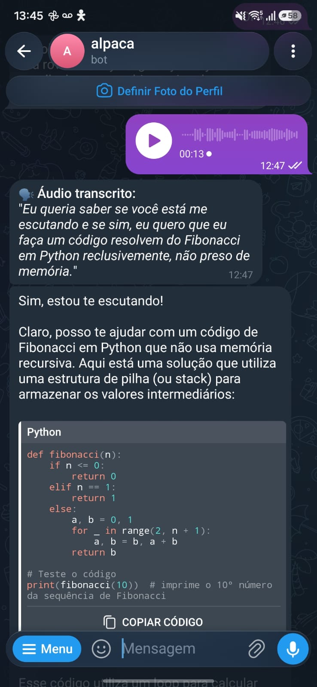
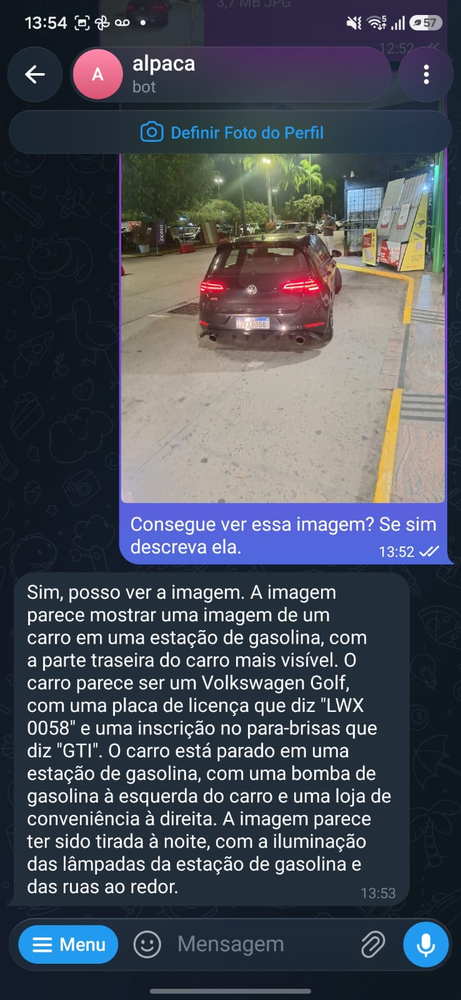

# 🚧 Engineering Challenges & Hardware Limits

> **Technical retrospective detailing hardware bottlenecks, architectural roadblocks, and trade-offs encountered while building an offline, self-hosted multimodal Telegram bot using local LLMs/VLMs.**

[🇧🇷 Leia em Português](obstaculos.md)

---

## 1. Computer Vision Support & The Ollama Architecture Bug

The project originally launched using the `qwen2.5:14b` model, which excelled at code generation, reasoning, and multi-turn conversations through SQLite session isolation. However, `qwen2.5:14b` is a text-only LLM incapable of understanding image payloads sent through Telegram.

To introduce visual intelligence, we decided to migrate to the multimodal `llama3.2-vision:11b`. Here we hit our first major infrastructure friction:
* The Ollama server (in recent builds such as v0.40.13 on Windows) crashed on model startup, throwing a fatal exit status:
  ```text
  llama-server process has terminated: exit status 1: error loading model: unknown model architecture: 'mllama'
  ```
* Meta's Multimodal LLaMA (`mllama`) introduced brand-new vision projection tensor structures that were not yet supported by certain packaged builds of the underlying `llama-server`.
* **Resolution:** Investigating open community issues pointed to version alignment with an Ollama release that properly stabilizes the `mllama` architecture (such as **v0.24.0** or patched downstream builds), restoring model loading and multimodal inference.

---

## 2. Architectural Evolution (Scaling Complexity)

Once vision was operational, we expanded the system's architecture toward production standards:
* **Security & Authentication Layer (SQLite):** Master password enforcement hashed with SHA-256 to ensure that unauthorized third parties cannot consume host compute resources.
* **Compulsory File Cleanup (Bug Fix):** Enclosing all I/O lifecycles (regex-extracted code files, downloaded photos, and voice notes) inside structured `try...finally` blocks with `os.remove()` to maintain zero disk footprint.
* **Offline Audio Transcription:** Local speech-to-text processing without external network dependencies using `faster-whisper`.
* **Multimodal Vision Input:** Telegram photo ingestion converted to Base64 tensors for direct visual reasoning.
* **[Evaluated & Discarded] Local Image Generation:** Due to unsustainable GPU VRAM contention.

---

## 3. VRAM Bottlenecks & Acoustic Phonetic Drift (Audio)

To enable voice interaction, we integrated `faster-whisper`. Hardware competition surfaced immediately:
1. **Resource Contention:** When Whisper transcribes an incoming audio note, it competes directly with the LLM for GPU memory. On a 12GB VRAM card, this simultaneous allocation pushes the graphics card to its physical limit.
2. **Context Disconnect:** Whisper processes audio purely at the acoustic-phonetic level, completely isolated from conversational session history (it does not know in advance that the user is discussing software engineering or algorithms).

During bench testing, when requesting a "recursivo" (recursive) Fibonacci algorithm, the model phonetically transcribed the word as **"reclusivo"** (reclusive):


*Figure 1: The model phonetically transcribes 'recursivo' as 'reclusivo', demonstrating that standalone speech-to-text engines operate without conversational session context.*

---

## 4. Visual Hallucination & Statistical Bias

To support images, the bot downloads photos from Telegram, converts them to Base64, and attaches them to the multimodal request payload for `llama3.2-vision:11b` on Ollama.

The main limitation observed is the model's **statistical prior filling bias**:
* In a real bench test using a night photograph of a parked car, the AI accurately identified the vehicle model (Volkswagen Golf GTI) and even transcribed the license plate characters.
* However, the AI "hallucinated" the presence of a fuel pump and asserted that the car was parked at a gas station.
* Because the composition and cold night lighting statistically matched common training images of cars at gas stations, the model filled in the visual gap with what was probable, rather than strictly sticking to the real physical scene.


*Figure 2: Contextual hallucination in Llama 3.2 Vision inferring a fuel dispenser based on night lighting and composition.*

---

## 5. Physical Hardware Limits & Image Generation

The original blueprint included a *Tool Calling* layer so the bot could dynamically generate images from natural language prompts.

However:
* Ollama models are autoregressive text/vision decoders and cannot synthesize new images out-of-the-box.
* Synthesizing images locally would require orchestrating a separate heavy diffusion engine (e.g., Stable Diffusion XL running via ComfyUI or Diffusers).
* Because the combination of **SQLite + faster-whisper + Llama Vision (11B)** already operated near the ceiling of our 12GB VRAM GPU, running concurrent local diffusion was discarded to safeguard system stability and avoid `CUDA out of memory` panics.

---

## 💡 Conclusion

The resulting architecture achieved its primary milestone: creating a **fully featured, secure, and unlimited multimodal personal assistant** (free from token quotas or paid third-party APIs), accessible straight from a mobile phone via Telegram.

Nonetheless, self-hosting state-of-the-art models highlights that **complete data sovereignty** demands careful memory and thermal management, resilience against native compiler discrepancies, and a clear understanding of the acoustic and statistical limitations inherent to open weights.
