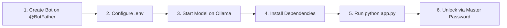

# 🤖 local-llm-telegram-bot

> **Conversational and multimodal interface for Large Language & Vision Models (LLMs/VLMs) running 100% locally via Ollama with Telegram, asynchronous SQLite, and offline Whisper.**

[🇧🇷 Leia em Português](README.pt-BR.md)

[](https://www.python.org/)
[](https://python-telegram-bot.org/)
[](https://ollama.com/)
[](https://www.sqlite.org/)
[](https://github.com/SYSTRAN/faster-whisper)

---

## 🎯 Project Purpose

The **local-llm-telegram-bot** transforms your Telegram app into a private, mobile, and direct interface for AI models running on your own hardware via **Ollama**, eliminating all dependencies on proprietary, paid APIs (such as OpenAI, Anthropic, or Google).

### Why run locally through Telegram?
* 🔒 **Data Sovereignty & Absolute Privacy:** Your prompts, files, images, and voice messages never leave your local infrastructure.
* 💸 **Zero Token Fees:** Unlimited requests and generations without subscriptions or per-call billing.
* 📱 **Everywhere Access:** Harness powerful open weights like **Llama 3.2 Vision (11B)** or **Qwen 2.5 (14B)** straight from your smartphone, tablet, or desktop over Telegram.
* 🧠 **Session & Context Isolation:** Manage independent conversation workspaces stored in SQLite (e.g., coding, research, general).

---

## ⚡ Key Features

| Feature | Description |
|---|---|
| 👁️ **Multimodal Computer Vision** | Send photos and diagrams (with or without captions) for deep visual reasoning powered by `llama3.2-vision:11b`. |
| 🎙️ **Offline Voice Transcription** | Voice notes and audio files are transcribed locally via `faster-whisper` and injected into the conversation stream. |
| 🗄️ **Async Session Management (SQLite)** | Persistent per-session context isolation: create, switch, list, rename, and delete conversation history. |
| 🔐 **Private Authentication Layer** | Password-protected bot. Requires a master security password (hashed with SHA-256) defined in `.env` before granting access. |
| 📁 **Code Extraction & File Dispatch** | AI-generated code snippets are automatically parsed, saved as standalone files, and sent as downloadable attachments. |
| 🧹 **Compulsory File Cleanup** | Structured `try...finally` resource lifecycle guarantees immediate disk deletion (`os.remove()`) for zero residual footprint. |
| 🗣️ **Semantic Intent Routing** | Natural language pre-processing dynamically routes requests (e.g., planning routines) without rigid slash commands. |

---

## 🛠️ Prerequisites

1. **Python 3.10 or newer** installed.
2. **Ollama** installed and running locally ([ollama.com](https://ollama.com)).
3. An active **Telegram** account.

---

## 🚀 Step-by-Step Setup Guide

Follow the workflow below to set up and start your private AI bot:



### 1. Create a Bot on @BotFather and Obtain Token
1. Open your Telegram client and search for the official **[@BotFather](https://t.me/BotFather)**.
2. Start the chat and send the command:
   ```text
   /newbot
   ```
3. Follow the prompts:
   * Provide a **display name** for your bot (e.g., `My Local AI Assistant`).
   * Provide a unique **username** ending with `bot` (e.g., `my_local_ai_bot`).
4. BotFather will provide your **HTTP API Token** (format: `123456789:ABCDefghIJKLmnOPQRstuvWXYZ`). **Copy this token.**

---

### 2. Configure Environment Variables (`.env`)
In the root directory of the repository, create your `.env` file from the provided template:

```bash
# Windows (PowerShell)
Copy-Item .env.example .env

# Linux or macOS
cp .env.example .env
```

Open the newly created `.env` file and set your credentials:

```env
# ===================================================
# TELEGRAM BOT & OLLAMA CONFIGURATION
# ===================================================

# 1. Paste your HTTP API Token from @BotFather
TELEGRAM_BOT_TOKEN=123456789:ABCDefghIJKLmnOPQRstuvWXYZ

# 2. Define a Master Security Password to lock your bot
BOT_MASTER_PASSWORD=your_secure_password_here

# 3. Ollama REST API settings
OLLAMA_BASE_URL=http://localhost:11434
OLLAMA_MODEL=llama3.2-vision:11b
OLLAMA_TIMEOUT=180

# 4. Offline Voice Transcription (faster-whisper)
WHISPER_MODEL_SIZE=base
WHISPER_DEVICE=cpu
WHISPER_COMPUTE_TYPE=int8

# 5. Database & Context Window
DATABASE_PATH=sessions.db
MAX_CONTEXT_MESSAGES=20
```

---

### 3. Start the Ollama Service and Pull Your Model
Ensure the Ollama engine is active:

```bash
ollama serve
```

In a separate terminal, pull your desired model (if not already downloaded):

```bash
# For Multimodal Vision (Photos + Text):
ollama run llama3.2-vision:11b

# Or for code-specialized text:
ollama run qwen2.5:14b
```

---

### 4. Install Project Dependencies
Setting up a Python virtual environment is highly recommended:

```bash
# Create virtual environment
python -m venv venv

# Activate on Windows (PowerShell):
.\venv\Scripts\Activate.ps1

# Activate on Linux / macOS:
source venv/bin/activate

# Install dependencies
pip install -r requirements.txt
```

---

### 5. Launch the Application
Run the entrypoint script:

```bash
python app.py
```
*(You can also run `python bot.py`).*

Your terminal will log database initialization and announce that the polling service is active.

---

### 6. First-Time Telegram Unlock
1. Open the chat with your bot in Telegram.
2. Press **Start** (or send `/start`).
3. The bot will respond that access is **locked and private**:
   > 🔒 **Access Restricted:** Please enter the master password to unlock the system.
4. Send the password you defined in `BOT_MASTER_PASSWORD`.
5. Access will be unlocked, and the bot will present the full welcome menu!

---

## 📖 Telegram Commands

All session commands are protected and require prior authentication:

| Command | Description |
|---|---|
| `/start` | Displays the welcome menu or requests the master password if unauthenticated. |
| `/ajuda` | Shows available commands and feature instructions. |
| `/novo [name]` | Creates an isolated session in SQLite and marks it as active. |
| `/listar` | Lists all your saved sessions and their total message count. |
| `/trocar [name]` | Switches the active context to another existing session. |
| `/renomear [new_name]` | Renames the current session (with duplicate name validation). |
| `/apagar [name]` | Permanently deletes a session and cascades deletion to all its messages. |
| `/trocarsenha [new_password]` | Updates the master security password stored in the database. |

---

## 🏗️ System Architecture

```
local-llm-telegram-bot/
├── app.py                # Main application entrypoint
├── bot.py                # ApplicationBuilder orchestrator and Telegram handlers
├── handlers.py           # Message, photo, audio, and protected command handlers
├── router.py             # Semantic intent dispatcher and natural language router
├── audio_service.py      # Async local audio transcription (faster-whisper)
├── database.py           # Async SQLite persistence (sessions, users, password hash)
├── ollama_client.py      # Async HTTP client for Ollama's REST API (/api/chat)
├── utils.py              # Markdown code block extractor and safe_remove_file
├── config.py             # Centralized settings and environment variables
├── media/                # Test artifacts and screenshots for documentation
├── CHALLENGES.md         # Detailed engineering challenges and hardware benchmarks
├── obstaculos.md         # Engineering challenges document in Portuguese
├── test_system.py        # Automated test suite with pytest (100% pass)
└── requirements.txt      # Project dependencies specification
```

---

## 🧪 Automated Testing

The repository includes a comprehensive test suite covering:
* Authentication barriers and unauthorized user rejection
* Secure password updates via `/trocarsenha`
* Session lifecycle, uniqueness, and cascade message deletion
* Semantic intent routing from natural language
* Base64 encoding and payload assembly for multimodal models
* **Compulsory physical deletion of temporary files on disk (`try...finally`)**

To run the test suite:
```bash
pytest test_system.py -v
```

---

## 📚 Engineering Challenges & Hardware Limits

To explore hardware limits (12GB VRAM), Whisper acoustic-phonetic misinterpretations, and visual hallucinations observed in Llama 3.2 Vision, read our technical retrospective:

👉 **[Read CHALLENGES.md](CHALLENGES.md)** *(or [obstaculos.md](obstaculos.md) in Portuguese)* with real bench test screenshots.

---

## 📄 License

Distributed under the MIT License. See `LICENSE` for details.
