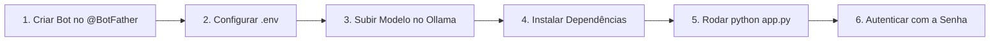

# 🤖 local-llm-telegram-bot

> **Interface conversacional e multimodal para modelos de linguagem e visão (LLMs/VLMs) executados 100% localmente via Ollama com Telegram, SQLite assíncrono e Whisper offline.**

[🇺🇸 Read in English](README.md)

[](https://www.python.org/)
[](https://python-telegram-bot.org/)
[](https://ollama.com/)
[](https://www.sqlite.org/)
[](https://github.com/SYSTRAN/faster-whisper)

---

## 🎯 Propósito do Projeto

O **local-llm-telegram-bot** foi projetado para transformar o seu aplicativo do Telegram em uma interface móvel e direta para os seus modelos de inteligência artificial rodando na sua própria máquina (via **Ollama**), eliminando a dependência de APIs pagas da OpenAI, Anthropic ou Google.

### Por que rodar localmente pelo Telegram?
* 🔒 **Privacidade e Soberania de Dados:** Suas conversas, arquivos, imagens e áudios nunca saem da sua infraestrutura local.
* 💸 **Custo Zero de Tokens:** Uso ilimitado sem cobranças por requisição ou assinaturas mensais.
* 📱 **Mobilidade Total:** Acesse o poder de modelos como **Llama 3.2 Vision (11B)** ou **Qwen 2.5 (14B)** direto do seu celular, tablet ou desktop pelo Telegram.
* 🧠 **Isolamento de Contexto:** Múltiplas sessões de trabalho separadas no SQLite para diferentes projetos (ex: programação, estudos, geral).

---

## ⚡ Funcionalidades

| Recurso | Descrição |
|---|---|
| 👁️ **Visão Multimodal** | Envie fotos no chat (com ou sem legenda) para análise visual pelo `llama3.2-vision:11b`. |
| 🎙️ **Transcrição de Voz Offline** | Áudios e notas de voz são transcritos localmente pelo `faster-whisper` e injetados no chat. |
| 🗄️ **Gestão de Sessões (SQLite)** | Histórico persistido por sessão isolada com suporte a criar, alternar, listar, renomear e apagar. |
| 🔐 **Autenticação e Segurança** | O bot é estritamente privado. Requer senha master (SHA-256) configurada no `.env` para liberar o uso. |
| 📁 **Extração de Código e Arquivos** | Blocos de código gerados pela IA são salvos e enviados automaticamente como arquivos para download. |
| 🧹 **Limpeza Física Compulsória** | Garantia estrutural em `try...finally` com `os.remove()` para destruir todo rastro temporário em disco. |
| 🗣️ **Roteamento Semântico** | Entende linguagem natural para planejar rotinas e executar tarefas sem comandos rígidos. |

---

## 🛠️ Pré-requisitos

1. **Python 3.10 ou superior** instalado na máquina.
2. **Ollama** instalado e em execução ([ollama.com](https://ollama.com)).
3. Uma conta ativa no **Telegram**.

---

## 🚀 Passo a Passo: Como Colocar no Ar

Siga as etapas abaixo para configurar e iniciar o assistente do zero:



### 1. Criar o Bot no @BotFather e Pegar o Token
1. No seu aplicativo do Telegram, procure pelo usuário oficial **[@BotFather](https://t.me/BotFather)**.
2. Inicie a conversa e digite o comando:
   ```text
   /newbot
   ```
3. O BotFather solicitará:
   * Um **nome de exibição** para o assistente (ex: `Meu Assistente Local`).
   * Um **username** exclusivo terminado em `bot` (ex: `meu_local_ia_bot`).
4. Ao finalizar, o BotFather exibirá o seu **HTTP API Token** (formato: `123456789:ABCDefghIJKLmnOPQRstuvWXYZ`). **Copie este token.**

---

### 2. Configurar as Variáveis de Ambiente (`.env`)
No diretório raiz do projeto, crie o seu arquivo `.env` a partir do modelo de exemplo:

```bash
# Windows (PowerShell)
Copy-Item .env.example .env

# Linux ou macOS
cp .env.example .env
```

Abra o arquivo `.env` gerado e preencha as variáveis:

```env
# ===================================================
# CONFIGURAÇÕES DO TELEGRAM BOT & OLLAMA
# ===================================================

# 1. Cole aqui o Token fornecido pelo @BotFather
TELEGRAM_BOT_TOKEN=123456789:ABCDefghIJKLmnOPQRstuvWXYZ

# 2. Defina uma Senha Master de Segurança para o seu bot
BOT_MASTER_PASSWORD=sua_senha_secreta_aqui

# 3. Configurações da API do Ollama
OLLAMA_BASE_URL=http://localhost:11434
OLLAMA_MODEL=llama3.2-vision:11b
OLLAMA_TIMEOUT=180

# 4. Transcrição de Voz Offline (faster-whisper)
WHISPER_MODEL_SIZE=base
WHISPER_DEVICE=cpu
WHISPER_COMPUTE_TYPE=int8

# 5. Banco de Dados e Histórico
DATABASE_PATH=sessions.db
MAX_CONTEXT_MESSAGES=20
```

---

### 3. Baixar e Rodar o Modelo no Ollama
Certifique-se de que o serviço do Ollama está rodando no terminal ou em segundo plano:

```bash
ollama serve
```

Em outro terminal, baixe o modelo multimodal configurado (caso ainda não o tenha):

```bash
# Para Visão Multimodal (Fotos + Texto):
ollama run llama3.2-vision:11b

# Ou para modelo focado em código/texto:
ollama run qwen2.5:14b
```

---

### 4. Instalar as Dependências do Projeto
Recomenda-se criar um ambiente virtual Python:

```bash
# Criação do ambiente virtual
python -m venv venv

# Ativação no Windows (PowerShell):
.\venv\Scripts\Activate.ps1

# Ativação no Linux / macOS:
source venv/bin/activate

# Instalação dos pacotes
pip install -r requirements.txt
```

---

### 5. Iniciar a Aplicação
Execute o arquivo principal:

```bash
python app.py
```
*(Você também pode utilizar `python bot.py`).*

Você verá no terminal a confirmação de que o banco SQLite foi inicializado e que o bot está escutando mensagens.

---

### 6. Primeiro Acesso e Desbloqueio no Telegram
1. Abra a conversa com o seu bot recém-criado no Telegram.
2. Pressione **Iniciar** (ou envie `/start`).
3. O bot responderá informando que o acesso é **restrito e privado**:
   > 🔒 **Acesso Restrito:** Por favor, envie a senha master para desbloquear o sistema.
4. Digite a senha master que você configurou na variável `BOT_MASTER_PASSWORD` do `.env`.
5. O acesso será liberado e você receberá o menu completo de boas-vindas!

---

## 📖 Comandos Disponíveis no Telegram

Todos os comandos de sessão são protegidos e exigem prévia autenticação:

| Comando | Descrição |
|---|---|
| `/start` | Exibe o menu principal ou solicita a senha caso não autenticado. |
| `/ajuda` | Mostra as instruções de uso e atalhos. |
| `/novo [nome]` | Cria uma nova sessão com contexto isolado no SQLite e a ativa. |
| `/listar` | Lista todas as suas sessões salvas e o total de mensagens de cada uma. |
| `/trocar [nome]` | Alterna o ponteiro da conversa para outra sessão existente. |
| `/renomear [novo_nome]` | Renomeia a sessão atual ativa (com verificação prévia de duplicidade). |
| `/apagar [nome]` | Exclui permanentemente a sessão e todas as mensagens vinculadas. |
| `/trocarsenha [nova_senha]` | Altera a senha master de acesso salva no banco de dados. |

---

## 🏗️ Arquitetura do Sistema

```
local-llm-telegram-bot/
├── app.py                # Entrypoint principal de execução
├── bot.py                # Orquestrador do ApplicationBuilder e Handlers do Telegram
├── handlers.py           # Processamento de texto, fotos, áudios e comandos protegidos
├── router.py             # Roteador semântico de linguagem natural e despachante
├── audio_service.py      # Transcrição assíncrona local de áudio (faster-whisper)
├── database.py           # Persistência SQLite assíncrona (sessões, usuários e senhas)
├── ollama_client.py      # Cliente HTTP assíncrono para a API REST do Ollama
├── utils.py              # Extrator de blocos de código e safe_remove_file
├── config.py             # Carregamento centralizado de variáveis de ambiente
├── media/                # Evidências e capturas de tela dos testes práticos
├── CHALLENGES.md         # Documento técnico de desafios de hardware em inglês
├── obstaculos.md         # Documento técnico de desafios de hardware em português
├── test_system.py        # Suíte de testes automatizados com pytest
└── requirements.txt      # Especificação das dependências do ecossistema
```

---

## 🧪 Testes Automatizados

O repositório acompanha uma suíte rigorosa de testes unitários e de integração cobrindo:
* Autenticação e bloqueio de usuários não autorizados
* Alteração segura de senha com `/trocarsenha`
* Ciclo de vida, unicidade e cascata de deleção de sessões
* Roteador semântico de intenções em linguagem natural
* Codificação Base64 e envio de imagens para modelos multimodais
* **Destruição física compulsória de arquivos residuais no disco (`try...finally`)**

Para executar os testes:
```bash
pytest test_system.py -v
```

---

## 📚 Obstáculos de Engenharia e Limitações

Para entender em profundidade os desafios práticos de engenharia, limites de VRAM (12GB), problemas fonéticos no Whisper e comportamentos de alucinação visual observados no Llama 3.2 Vision, leia o documento completo:

👉 **[Consulte o obstaculos.md](obstaculos.md)** *(ou [CHALLENGES.md](CHALLENGES.md) em inglês)* com prints e análises reais de bancada.

---

## 📄 Licença

Distribuído sob a licença MIT. Consulte o arquivo de licença para obter mais informações.
