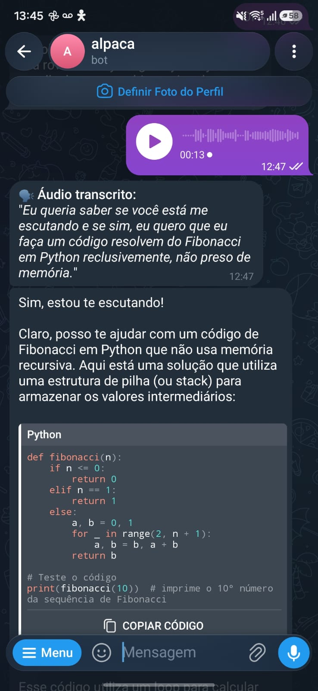
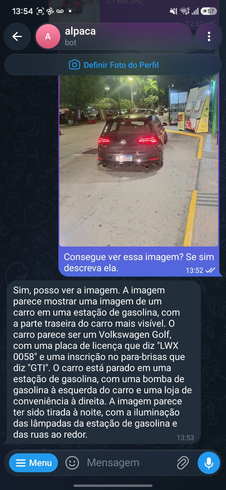

# 🚧 Obstáculos e Aprendizados de Engenharia

Este documento registra os principais desafios de engenharia de software, limitações de hardware e trade-offs encontrados durante a construção do bot de Telegram integrado a LLMs e VLMs locais via Ollama.

---

## 1. O Problema da Visão e o Bug de Arquitetura do Ollama

O projeto começou rodando o modelo `qwen2.5:14b`, que funcionou perfeitamente para geração de código e manutenção de conversas (com a arquitetura de sessões isoladas no SQLite já operante). No entanto, o `qwen2.5:14b` é um modelo puramente textual, o que impedia o envio e a interpretação de imagens pelo Telegram.

Para resolver essa limitação, a estratégia foi migrar para o modelo multimodal `llama3.2-vision:11b`. Foi aqui que ocorreu o primeiro grande atrito de infraestrutura:
* O servidor Ollama (em builds recentes como a 0.40.13 no Windows) apresentou erro fatal ao carregar o modelo:
  ```text
  llama-server process has terminated: exit status 1: error loading model: unknown model architecture: 'mllama'
  ```
* A arquitetura multimodal da Meta (`mllama` - Multimodal LLaMA) introduziu novos tensores de visão não reconhecidos por certas compilações do `llama-server`.
* **Resolução:** A investigação em discussões da comunidade apontou para o ajuste de versão e alinhamento do servidor Ollama para uma versão estável compatível (como a **0.24.0** ou builds corrigidas para a arquitetura `mllama`), normalizando a execução e a inferência de imagens.

---

## 2. A Evolução da Arquitetura (Escalando a Complexidade)

Com o modelo de visão funcional, o escopo da aplicação foi expandido para um nível profissional de produção, implementando:
* **Camada de Segurança e Autenticação (SQLite):** Senha master protegida via hash SHA-256 no banco de dados para impedir que terceiros usem os recursos locais do host.
* **Rotina Compulsória de Limpeza (Bug Fix):** Envolvimento de todas as rotinas de I/O (scripts extraídos via Regex, fotos baixadas e áudios de voz) em blocos estruturados `try...finally` invocando `os.remove()`, garantindo rastro físico zero em disco.
* **Transcrição de Áudio Offline:** Inferência local sem internet usando `faster-whisper`.
* **Entrada de Imagens (Visão Computacional Multimodal):** Leitura de fotos em Base64 para análise visual direta.
* **[Avaliado e Descartado] Geração Local de Imagens:** Concorrência inviável de VRAM.

---

## 3. O Gargalo de VRAM e a Transcrição Fonética (Áudio)

Para o processamento de voz, foi integrado o `faster-whisper`. O atrito físico de recursos ficou evidente:
1. **Concorrência de Recursos:** Quando o Whisper entra em ação para decodificar um áudio, ele concorre com o LLM pelos recursos computacionais. Em placas com 12 GB de VRAM, essa sobreposição leva o consumo de memória ao limite absoluto.
2. **Desconexão Semântica do Whisper:** O Whisper opera estritamente no domínio acústico-fonético, isolado do contexto da sessão de conversa (ele não sabe previamente que o usuário está tratando de código ou ciência da computação).

Em um teste prático, ao solicitar um algoritmo Fibonacci **"recursivo"**, o modelo transcreveu foneticamente como **"reclusivo"**:


*Figura 1: O modelo transcreve foneticamente 'recursivo' como 'reclusivo', evidenciando que motores de transcrição operam sem conhecimento prévio do contexto da sessão.*

---

## 4. Alucinação Visual e Viés Estatístico

Para suportar o envio de imagens, o bot baixa a foto enviada pelo Telegram, converte para Base64 e anexa ao payload da requisição multimodal do `llama3.2-vision:11b` no Ollama.

A limitação observada reside no **viés de preenchimento estatístico** dos modelos de visão:
* Em um teste real com a foto de um carro estacionado à noite, a IA identificou com excelente precisão o modelo do veículo (Golf GTI) e até detalhes da placa.
* Contudo, a IA "alucinou" a existência de uma bomba de gasolina e afirmou categoricamente que o carro estava estacionado em um posto de combustíveis.
* Como a iluminação noturna fria e o enquadramento lembravam esteticamente um ambiente de posto, o modelo preencheu a lacuna com a cena estatisticamente mais provável nos seus dados de treino, ignorando a ausência física do objeto na imagem real.


*Figura 2: Alucinação contextual no Llama 3.2 Vision ao inferir a presença de uma bomba de combustível a partir da iluminação noturna e composição da cena.*

---

## 5. O Limite Físico do Hardware e a Geração de Imagens

O plano inicial contemplava um sistema de *Tool Calling* para que o bot gerasse imagens nativamente em resposta à linguagem natural.

No entanto:
* Modelos LLM/VLM locais no Ollama não sintetizam imagens diretamente.
* Seria necessário orquestrar em paralelo um segundo motor de difusão pesado (como Stable Diffusion XL rodando via ComfyUI ou Diffusers).
* Como o empilhamento de **SQLite + faster-whisper + Llama Vision (11B)** já operava no teto dos 12 GB de VRAM da GPU, a geração local concorrente de imagens por difusão foi descartada para preservar a estabilidade operacional e evitar erros de `CUDA out of memory`.

---

## 💡 Conclusão

A arquitetura final alcançou o objetivo central: criar um **assistente pessoal multimodal completo, seguro e ilimitado** (sem cobrança de tokens ou assinaturas de APIs externas), diretamente acessível via Telegram no smartphone ou desktop.

A experiência prática comprova que a **soberania de dados e privacidade total** exige lidar com restrições térmicas e de memória da máquina, tolerância a particularidades de compilação dos binários locais e compreensão crítica dos limites estatísticos e fonéticos dos modelos abertos.
